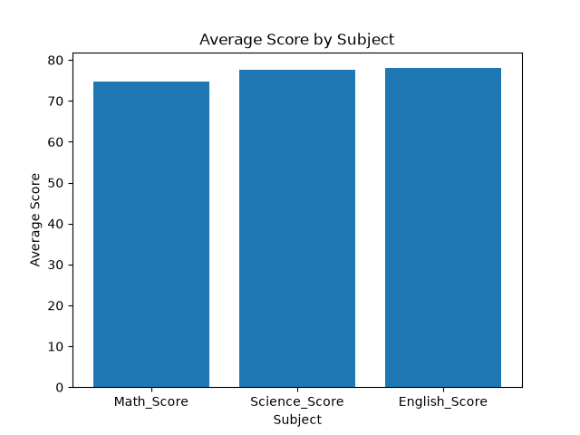
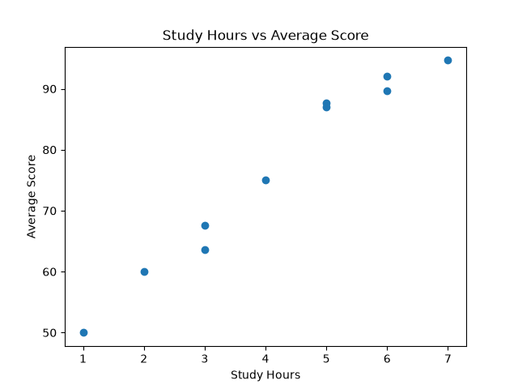
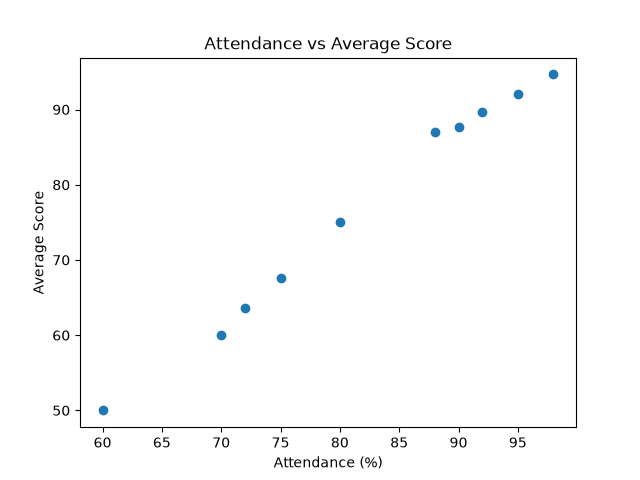

# Student Performance Analyzer

## Project Overview

Student Performance Analyzer is a data analysis project that explores the academic performance of students using Python, Pandas, NumPy, and Matplotlib.

The project analyzes students' study hours, attendance, and subject-wise scores to identify patterns and relationships in academic performance.

## Dataset

The dataset contains information about 10 fictional students.

The dataset includes the following columns:

- `Student_ID` — Unique identifier for each student
- `Gender` — Gender of the student
- `Study_Hours` — Number of hours spent studying
- `Attendance` — Student attendance percentage
- `Math_Score` — Mathematics score
- `Science_Score` — Science score
- `English_Score` — English score

## Technologies Used

- Python
- Pandas
- NumPy
- Matplotlib
- Jupyter Notebook
- GitHub

## Analysis Performed

The following analyses were performed:

- Explored the structure and characteristics of the dataset.
- Checked for missing values and duplicate records.
- Examined data types and summary statistics.
- Calculated the average score of each student.
- Identified students with the highest and lowest average scores.
- Compared average performance across genders.
- Analyzed the relationship between study hours and average score.
- Analyzed the relationship between attendance and average score.
- Compared average scores across different subjects.

## Visualizations

### Average Score by Subject



### Study Hours vs Average Score



### Attendance vs Average Score



## 8. Correlation Analysis
Correlation analysis was used to examine the relationships between Attendance, Study Hours, and Average Score.

The results show very strong positive correlations between these variables. Attendance has the strongest correlation with Average Score (0.996), while Study Hours also show a very strong positive correlation with Average Score (0.983).

Correlation indicates a relationship between variables but does not prove causation.

## Key Insights

- Study hours and average score show a positive relationship in the dataset.
- Attendance and average score show a positive relationship in the dataset.
- Students with higher overall scores performed consistently well across the three subjects.
- The average scores differ slightly across Mathematics, Science, and English.

## Project Structure

```text
Student-Performance-Analyzer/
│
├── data/
│   └── student_performance.csv
│
├── Notebook/
│   └── student_performance_analysis.ipynb
│
├── Images/
│   ├── attendance_vs_average_score.png
│   ├── average_score_by_subject.png
│   └── study_hours_vs_average_score.png
│
└── README.md

## How to Run

1. Clone this repository.
2. Open the project folder in Jupyter Notebook.
3. Open `Notebook/student_performance_analysis.ipynb`.
4. Make sure the dataset is available in the `data` folder.
5. Run the notebook cells from top to bottom.

## Conclusion

This project demonstrates how Python can be used to explore, analyze, and visualize student performance data.

Through this project, I practiced data cleaning, exploratory data analysis, statistical summaries, data visualization, and extracting meaningful insights from a dataset.

